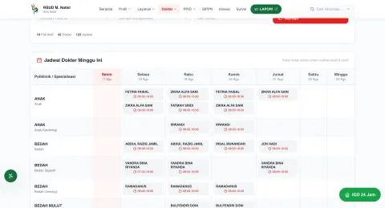
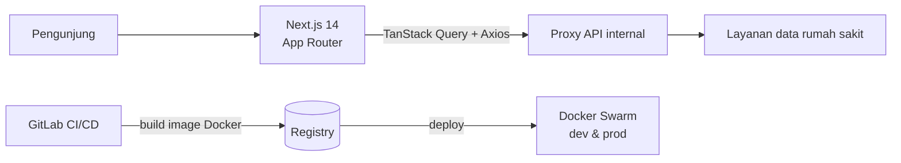
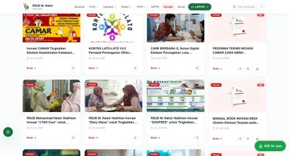
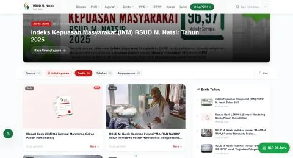

# Website Resmi RSUD Mohammad Natsir Solok

> Situs resmi rumah sakit umum daerah kelas B di Kota Solok, Sumatera Barat: profil, layanan, jadwal dokter, berita, dan informasi publik, dengan identitas visual Minangkabau. Data dibaca dari sistem rumah sakit melalui proxy API internal sehingga sistem inti tidak terekspos ke publik.

| | |
|---|---|
| Instansi | RSUD Mohammad Natsir Solok |
| Peran saya | Pengembangan frontend, pengelolaan data aplikasi, integrasi layanan backend melalui proxy API internal, analisis dan desain sistem, CI/CD |
| Status | Produksi |

## Fitur utama

- Profil rumah sakit, layanan dan poliklinik, fasilitas.
- Jadwal dokter yang diambil dari sistem rumah sakit.
- Berita, pengumuman, dan galeri.
- Kontak, lokasi, dan kanal pengaduan.
- Aksesibel dan responsif, dioptimalkan untuk performa di ponsel.

## Arsitektur

## CI/CD

Pembaruan website dikelola lewat pipeline GitLab dengan tiga tahap:

1. **image-building** — build image Docker otomatis untuk setiap perubahan.
2. **deploy-dev** — deployment ke lingkungan development dipicu manual.
3. **deploy-prod** — rilis ke produksi.

Layanan berjalan di Docker Swarm; environment layanan disinkronkan ulang setelah rotasi secret.

## Tech stack

| Kategori | Teknologi |
|---|---|
| Framework | Next.js 14 (App Router), TypeScript |
| Styling | Tailwind CSS, design system internal |
| Data fetching | TanStack Query, Axios |
| State | Zustand |
| Animasi | Framer Motion |
| Deploy | Docker, Docker Swarm, GitLab CI/CD |

## Dokumen proyek

Sebagai System Analyst saya menyusun dokumen pengembangan resmi website ini: KAK, dokumen desain sistem, hasil uji dan UAT, panduan pengguna, serta berita acara sosialisasi dan serah terima.

## Galeri

| | |
|---|---|
|  |  |

---

> **Catatan kerahasiaan.** Kode sumber aplikasi ini private karena milik/dipakai instansi. Repo ini hanya menjelaskan konteks, fitur, arsitektur, dan peran saya. Tidak ada kode, data pegawai, data pasien, alamat server, maupun kredensial di sini.

**Maizan Insani Akbar** · Software Engineer & System Analyst · [Portfolio](https://izanmaizan.vercel.app) · [LinkedIn](https://www.linkedin.com/in/izanmaizan/) · [GitHub](https://github.com/izanmaizan)
